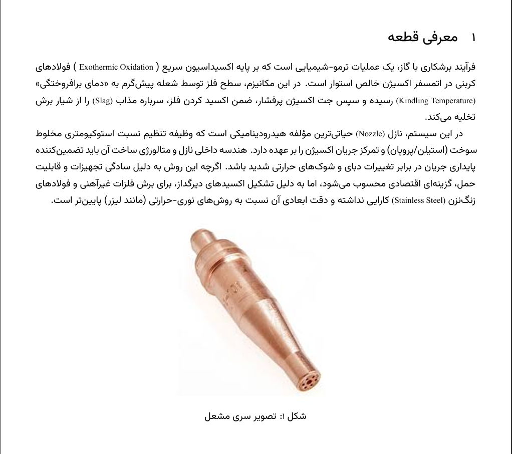
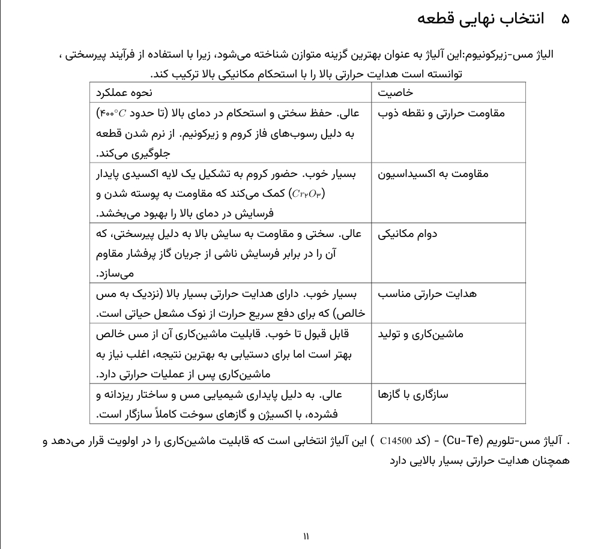
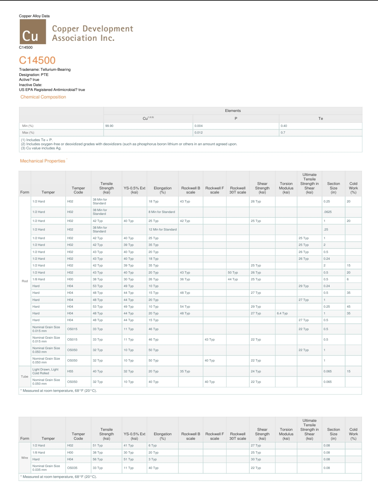

# Torch Nozzle Material Selection

## 1. Project Overview

This project focuses on selecting a suitable metallic material for an oxy-fuel cutting torch nozzle. The study evaluates material properties, operating conditions, manufacturing requirements, and cost considerations to identify an appropriate material for the application.

## 2. Component Description

Oxy-fuel cutting is a thermochemical process in which a metal is heated and oxidized by a high-purity oxygen jet. The torch nozzle controls gas flow and helps maintain stable flow characteristics during operation.

*Figure 1. Oxy-fuel cutting torch nozzle.*

## 3. Material Selection Constraints

A key constraint of this project was that the material had to be selected **exclusively from the metallic materials group**.

Ceramics, polymers, and composite materials were excluded from the candidate selection process. The evaluation therefore focused on comparing metallic materials and alloys according to their thermal, mechanical, chemical, and manufacturing properties.

The main selection criteria included:

- Thermal conductivity and heat dissipation
- High-temperature performance
- Oxidation resistance
- Mechanical strength and durability
- Machinability and dimensional accuracy
- Manufacturing feasibility and cost

## 4. Final Material Selection

Based on the evaluation presented in the project report, **Tellurium Copper (CuTe, UNS C14500)** was selected as the preferred material, with particular consideration given to its machinability and thermal properties.

*Figure 2. Final material selection and comparison of material properties.*

## 5. Material Datasheet

The material datasheet was used to examine the chemical composition and mechanical properties of the selected copper alloy.

*Figure 3. Technical datasheet for C14500 tellurium copper.*

## 6. Engineering Skills

- Engineering materials selection
- Metallic alloy comparison
- Thermal and mechanical property evaluation
- Manufacturing process considerations
- Machinability assessment
- Technical datasheet interpretation
- Engineering decision-making under material constraints

## 7. Complete Project Report

The complete project report is available in Persian and includes the component description, material selection criteria, candidate evaluation, final selection, and supporting technical information.

[View or download the complete project report (PDF)](./TorchNozzleMaterialSelection.pdf)
